  

**Java** · **Spring Boot** · **PostgreSQL** · **REST APIs** · **JWT** · **RAG**

[Portfolio](https://shvmmonk.vercel.app) · [LinkedIn](https://www.linkedin.com/in/shivam-goswami-88633124a/) · [Email](mailto:shvmnath.monk@gmail.com)

Designed as SVGs · rendered with Python · verified GitHub contribution data refreshed daily

